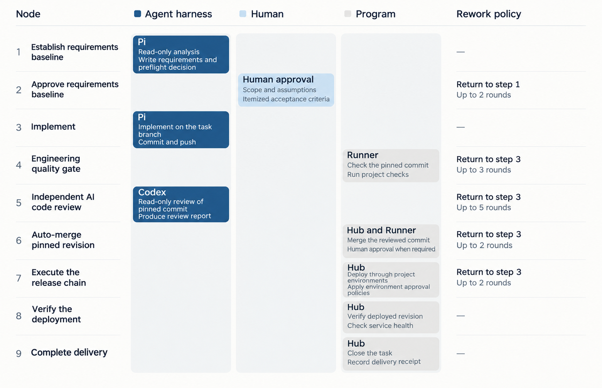
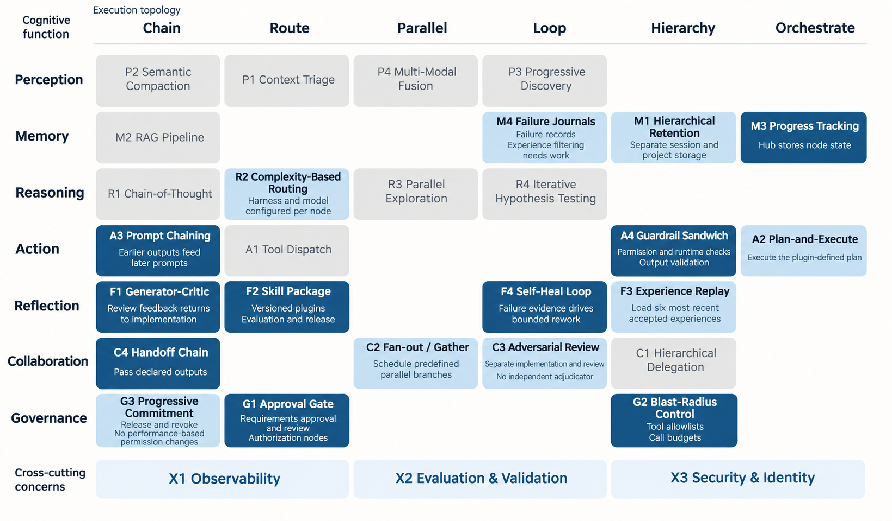
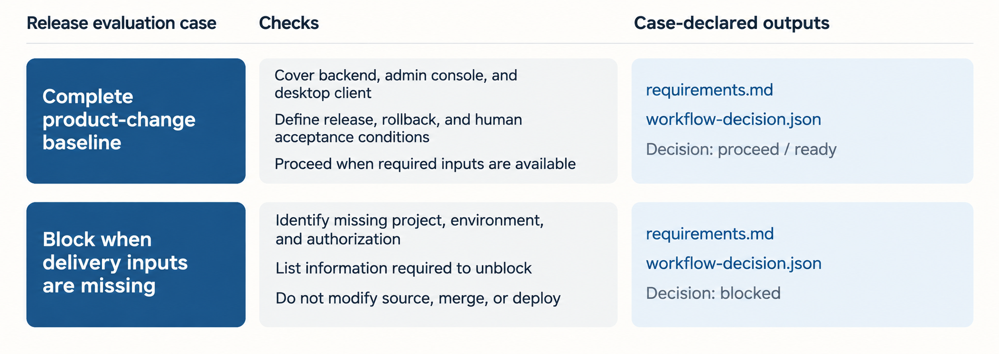

<a href="https://adpsagent.com/cases/">Cases</a>/Open-source engineering case

<header class="publication-head">

ADPS Open-Source Engineering Case

<h1>After the Agent Writes the Code: A Closer Look at SoduWork</h1>

Follow a delivery-status dashboard through SoduWork&#x27;s workflow to examine agent decisions, review evidence, rework, and release checks.

Jia Huang · <time datetime="2026-11-18">2026-11-18</time>

</header>

Ask an agent to change a feature in an existing codebase, and it can finish surprisingly quickly. But (there was always going to be a but) quite a bit of work remains. Did it miss a requirement? Have we tested the code we are about to merge? Once deployed, are users running the expected version, and does it behave as intended?

When someone works with an agent on their own, they can keep track of these things themselves. A team needs a way to make them part of its everyday workflow.

SoduWork is an open-source project that takes on this part of the job. It serves teams across engineering and other roles. Employees submit requests through a desktop client; a Hub stores tasks, workflows, and approval records; a Runner executes work locally or on a remote host. The Runner launches the chosen agent harness, which handles model interaction and tool calls for its assigned step. Teams can package their working methods as versioned plugins, specifying the steps, inputs, outputs, and completion criteria.

The project uses the MIT license and supports deployment on a company's own servers. The developer documentation lists nine agent harnesses, including Pi, OpenCode, and Codex, with harness and model choices configurable by task and workflow step. I like having that choice: an engineering team can use different setups for different kinds of work.

## Following a feature from requirements to production

The built-in `software-delivery` plugin gives us a concrete example to examine with [ADPS](https://adpsagent.com/), the Agent Design Patterns Society's dual-axis framework.

I introduced the framework in [*Designing AI Agents*](https://www.manning.com/books/designing-ai-agents) and have continued developing it with the ADPS community. One axis describes cognitive functions: perception, memory, reasoning, action, reflection, collaboration, and governance. The other describes execution topology: chain, routing, parallel, loop, hierarchy, and orchestration.

Several agents working on a task can mean very different things. They might debate a goal repeatedly, hand over agreed deliverables, or add new steps as they go. Separating the two axes helps us ask what each agent decides and how the work is organized.

Consider a request for a project delivery status dashboard. Employees need to see progress in the client. Administrators need to configure who can see which projects. The backend must supply the data, and the client needs an upgrade and release path. This is also the feature used in one of the plugin's built-in evaluation cases.

The plugin arranges delivery into nine nodes. Agents handle requirements analysis, implementation, and code review. A person approves the requirements baseline. Programs handle the other five: engineering checks, merging, release, post-release verification, and closure. Each deployment environment has its own policy on whether a release also needs human approval.

<figure class="matrix-figure">

<figcaption>Figure 1. SoduWork&#x27;s requirements-to-production workflow.</figcaption>
</figure>

The requirements node produces two files. `requirements.md` records user scenarios, affected interfaces and services, permissions, exceptional cases, and acceptance criteria. `workflow-decision.json` records whether work can proceed. The agent checks the toolchain, repository, and credentials; if something essential is missing, it identifies what is needed before work can continue.

For the dashboard, that means answering fairly ordinary questions: who can see which projects, what an empty list looks like, what happens when the API fails, and whether older clients remain compatible. A person confirms this baseline before implementation begins, and both the implementer and reviewer use it later. Waiting until the agent has written several rounds of code to explain “that isn't what I meant” is a rather expensive approach to token economics.

Inside the implementation node, the agent can inspect code, follow dependencies, and choose how to make the change. The Hub holds the full workflow and schedules the next step from the recorded node states. Each run uses a fixed plugin version, and code checks and review are required steps.

I agree with this division of responsibility. It is also how I think about separating the narrative plane from the control plane in ADPS: the model reasons about the work, while the workflow keeps track of which actions are permitted and when. How to implement a feature often requires reading the code. The conditions for merging it are usually rules the team already knows. SoduWork gives each kind of decision an appropriate place.

There are limits within a node, too. The implementation node may run at most six build or test validation commands. The formal quality node performs the checks against a fixed commit. The review node has a budget of zero validation commands: it reads the results and examines the code without repeating the build and test runs. These limits apply to validation commands, not every tool call. Six may be insufficient for a complex project; a team can change the setting.

The limits appear in both prompts and execution policies. The Runner examines tool-call events reported by the harness and terminates a run if it detects a violation. That check happens after the event, though. By the time the Runner receives the record, the action may already have taken place. For operations such as deleting data or changing production configuration, I would restrict permissions in the tools and execution environment as well.

If an engineering check finds a code defect, the workflow returns to implementation with the results, then checks the revised code. Quality checks allow up to three rework rounds; code review allows up to five, counted separately. Missing credentials, insufficient authorization, or a misconfigured environment cause the workflow to pause until a person resolves them. Rewriting business logic will not fix a deployment target that has never been configured. In ADPS, this is also how we distinguish steps an agent should retry from problems that need a person.

The engine also compares the remote commits returned before and after rework. If the commit has not changed, an agent's new explanation of why the work is “done” does not count as progress.

Previous review reports remain on record, but the next attempt receives a structured list of current issues rather than the entire accumulated history. A code comment explains why: replaying all the old reports had prevented Pi from completing a commit.

## Reviewing code, remembering experience

Several ADPS patterns are visible in this workflow. The Hub's node states provide M3, Progress Tracking. Implementation followed by review and revision uses F1, Generator-Critic. Repairing a failed check with its results as input, then checking again, uses F4, the Self-Heal Loop.

The reviewer's inputs deserve a closer look. It receives the specified commit's diff against the target branch, the requirements baseline, quality-check results, and the task's background, attachments, and available project context. Its report must identify issue locations, severity, and suggested changes. Blocking issues send the task back to implementation. A successful review allows the merge node to merge the reviewed commit.

Suppose the dashboard's API, page, and client entry point are all present, and the existing tests pass. But the list endpoint returns projects the current user has no permission to see. A reviewer reading only the developer's summary, “permissions supported,” might accept it. A reviewer with the visibility requirements and the actual query can compare the two and notice the missing filter.

There is another common complication: someone pushes more code after review. SoduWork records the review against its commit and checks that identity at merge time. Acceptance reports similarly refer to individual acceptance criteria, supporting evidence, and a registered delivery version. In the dashboard example, that lets the team identify which implementation was checked against the visibility requirement.

The plugin uses Pi for implementation and Codex for review, although SoduWork permits other combinations and some built-in workflows use Pi for both. A harness and a model are different choices. Switching from Pi to Codex can still leave the underlying model unchanged. And even two different models may miss a requirement that nobody wrote down. If a team requires a different model for review, it needs to configure that explicitly and check what actually ran, including any fallback when the requested harness was unavailable.

I mapped the platform's mechanisms against the ADPS matrix below. The strongest matches are around task progress, handoffs, checks, approval, and execution constraints.

<figure class="matrix-figure">

<figcaption>Figure 2. SoduWork mapped to the 27 ADPS patterns. Dark blue: 9 clear matches. Light blue: 8 partial matches. Gray: 10 patterns not identified in this analysis. Empty cells have no core ADPS pattern assigned. X1–X3 are cross-cutting concerns. This is a design index, not a performance score.</figcaption>
</figure>

What happens to the experience from a completed task? SoduWork saves project summaries. A successful execution initially produces a candidate; after the task has been accepted and closed, the summary becomes accepted experience. Later tasks read the six most recent accepted summaries from the same project, with instructions to verify them against the current workspace.

That delay makes sense to me. The agent finishing and the team accepting its work can be separated by further corrections. Saving the initial approach as a proven success could teach the next task an error that is still being fixed.

Reading only the six most recent summaries may leave out an older, more relevant lesson. Suppose a team fixes a permissions bug, then completes several interface changes. When another permissions task arrives, the relevant lesson may already have dropped out of those six entries. I would like each experience to include its applicable conditions, the code or environment version, and the evidence that the approach worked. A new task could then retrieve experience that fits its situation.

Failures deserve attention here as well. Failed execution creates a project memory, but it is outside the accepted-experience path used by later tasks. Useful clues may remain in sessions, workspaces, or rework records. There is room to turn verified failures into reusable examples: what went wrong, how it was recognized, and which repair worked.

Teams can also reuse a method through a plugin. It packages instructions, inputs and outputs, tool requirements, and completion criteria in a versioned unit for organizational review and publication. Versions that declare evaluation cases must pass the relevant checks. This corresponds closely to F2, Skill Package. Different projects can bind the same plugin to different harnesses and models.

Feedback on a task can become an improvement proposal. An accepted proposal is associated with a new version of the same plugin; it is recorded as applied once that version has passed review and been enabled. Existing runs continue with their original version.

## Testing the parts the team will depend on

A workflow makes a method repeatable. We still need to find out how well the agents perform their assigned work, whether checks catch defects, and whether rework fixes them. For the dashboard, a useful question is whether the reviewer actually detects the missing permissions filter.

The plugin includes two evaluation cases for publication as a team working method:

- The dashboard request checks whether the executor produces a complete requirements baseline, covering backend data, administrative visibility settings, the employee-facing client, upgrades, and release arrangements.
- A deliberately underspecified request asks for a feature to be shipped quickly without supplying the target project, environment, or authorization. The executor should identify what is missing, say that work cannot proceed, and explain what would unblock it.

<figure class="matrix-figure">

<figcaption>Figure 3. The software-delivery plugin&#x27;s two publication evaluation cases.</figcaption>
</figure>

These cases focus on the requirements file and the preflight decision. The platform gives each case to an executor to run individually; it does not take it through all nine workflow nodes. The cases can tell us about requirements preparation and prerequisite checks. Implementation, review, rework, and release need further evaluation.

I would keep both cases and continue with the same dashboard task. For review, prepare a commit with the permissions filter deliberately omitted. Supply the requirements baseline and quality-check results, then see whether the reviewer identifies the unauthorized projects being returned, locates the defect, and gives a usable repair suggestion. Include correct implementations too, to find out whether it blocks code unnecessarily.

Next, pass the review findings to the implementation node and inspect the new commit. Has it repaired the permissions issue? Do the existing features still work? If it returns the same code with a different explanation, does the workflow detect the lack of progress?

Then run the complete delivery in an isolated environment. Check the required approvals, the reviewed change on the target branch, the deployed artifact's origin in that merge, and the behavior against the acceptance criteria.

I would start with problems the team has actually encountered. A missed permissions check becomes a permissions case. Several rounds of rework with no code changes become a no-progress case. The team's concerns can become scenarios it can test repeatedly.

The same cases can help with model selection. A cheaper review model may behave differently even when every workflow step remains unchanged. Before switching, rerun the same cases to compare which defects the new model finds, which it misses, and whether it creates unnecessary rework. I would include the time spent on human review, false positives, and repairs in the cost comparison.

Keep the useful cases. When a model, tool permission, or execution environment changes, rerun the affected checks; when handoffs change, check that the participating nodes still work together. Over time, the team gets evidence from its own tasks for choosing a harness and model.

## What I would change in my own ADPS selection card

Examining SoduWork sent me back to my pattern selection card.

The earlier decision tree was fairly simple. When a scenario involved substantial collaboration, it could steer the reader toward hierarchical delegation or parallel execution without giving orchestration enough attention. I want to add a question: once several participants are involved, have we already agreed what each step does, what it produces, who checks it, and what allows work to continue?

If those things are clear, orchestration deserves early consideration.

In SoduWork's delivery workflow, the implementation agent still chooses how to change the code. The reviewer still judges the implementation against the requirements. The orchestrator determines when the next step starts, where a failed task returns, and which commit may be merged.

The cognitive axis helps identify the abilities required at each step: understanding requirements, reasoning about an implementation, making changes, reflecting on results, and governing approval. The topology axis helps organize those abilities. Here, orchestration contains rework loops, while individual agents retain room to decide how to perform their tasks.

For our dashboard, an agent needs to read the code before deciding how to change an endpoint, organize the page, or place a permissions check. The workflow can verify whether the requirements were approved, whether checks passed, and whether the commit being merged is the one that was reviewed.

This is what I like most about SoduWork's approach. It puts useful autonomy inside a delivery process that a team can inspect and configure. I would like to see these methods accumulate comparable evaluation results across projects and models, and verified experience find its way into the tasks where it is relevant. (I'd be glad to compare notes with others working on this.)

If you are introducing agents into a team's work, you can download [SoduWork from GitHub](https://github.com/mdiri-ai/SoduWork) and follow the [developer documentation](https://dev.soduwork.ai/). Start with a small task whose acceptance criteria are clear, and take it through requirements, review, rework, and delivery. If something goes wrong, an issue with reproduction steps and relevant records will help the maintainers investigate.

If you find the project useful, give it a star and follow its development.

<!-- PAGE-CHRONICLE:START -->

<section aria-labelledby="page-chronicle-title" class="page-chronicle">
<h2 id="page-chronicle-title">Sources and disclosure</h2>

The mechanism analysis draws on SoduWork's <a href="https://github.com/mdiri-ai/SoduWork/tree/6bde0b3f923d8a364d9dd270b0fe72be575e12ec">public source revision 6bde0b3</a> and developer documentation. The additional evaluation scenarios and experience-retrieval changes are recommendations. This article does not report results from an end-to-end delivery run with live models.

<dl>

<dt>Author and source</dt><dd>Jia Huang. This article was commissioned by the SoduWork project.</dd>

<dt>Manuscript date</dt><dd><time datetime="2026-11-18">2026-11-18</time></dd>

<dt>First published on ADPS</dt><dd><time datetime="2026-11-18">2026-11-18</time></dd>

</dl>

<a href="https://adpsagent.com/chronicle/#cases-soduwork-software-delivery">View in the ADPS Chronicle</a>

</section>

<!-- PAGE-CHRONICLE:END -->
