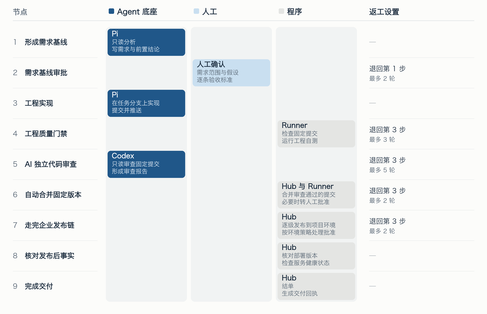
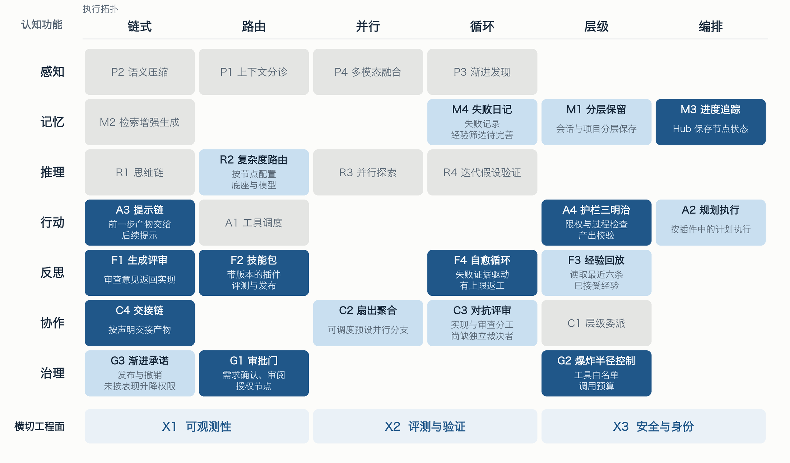
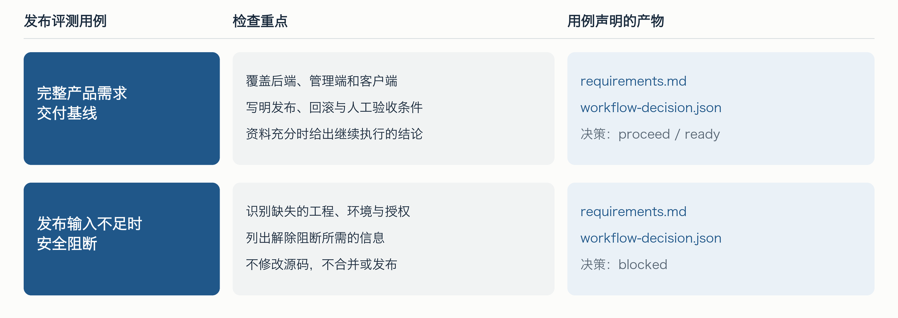

<a href="https://adpsagent.com/zh/cases/">案例</a>/开源工程案例

<header class="publication-head">

ADPS 开源工程案例

<h1>用 ADPS 双轴框架读 SoduWork：Agent 的自主性放在哪里</h1>

沿着一个项目交付状态总览功能，分析 SoduWork 如何组织需求、审查、返工与发布，以及哪些决定交给 Agent、哪些由流程核对。

黄佳 · <time datetime="2026-11-18">2026-11-18</time>

</header>

当我们让 Agent 对原有代码库改一个功能，Agent很快就可以完成。但是（这里肯定会有但是）在代码生成完以后，往往还有一长段工作。我们需要检查需求有没有漏掉？需要反复测试准备合并的代码。等到部署完成，还要确认用户当前使用的版本和上线后的行为都没有出现异常。

**一个人使用 Agent 时，这些事情可以靠自己盯着。如果是团队共用一套方法，那就需要把它们安排进流程中来。**

而近期的一个优秀开源项目 SoduWork 做的正是上面描述的这一段工作。它面向多岗位团队，覆盖研发与非研发工作。平台把需求、执行、审查和交付组织起来：员工在桌面客户端提出需求，Hub 保存任务、工作流与审批记录，Runner 在本机或远程主机上执行，并启动所选的 Agent 底座（Harness）。底座负责和模型交互、调用工具，完成分给它的那一步任务。团队还可以把自己的工作方法做成带版本的插件，在里面写明步骤、输入输出和完成要求。

> **咖哥发言：** SoduWork 项目采用 MIT 许可开源，支持在企业自己的服务器上私有化部署。[开发者文档](https://dev.soduwork.ai/)列出 Pi、OpenCode、Codex 等 9 种 Agent Harness，团队可以按任务和工作流步骤选择底座与模型。这种配置给了工程团队很大的便利和很多的选择权。

## 用 SoduWork 的“需求到生产”插件支持任务交付

下面，我们选用 SoduWork 内置的“需求到生产”研发插件，从一项具体的任务交付中，用 [ADPS Agent设计模式双轴框架](https://adpsagent.com/)分析它的设计。

我在[《Designing AI Agents》](https://www.manning.com/books/designing-ai-agents)中提出了Agent设计的双轴框架，后来在 ADPS（Agent Design Patterns Society）社区中持续完善。这个框架有两个设计轴，一条轴看认知功能：感知、记忆、推理、行动、反思、协作、治理；另一条轴看执行拓扑：链式、路由、并行、循环、层级、编排。同样是几个 Agent 共同完成任务，有的系统让它们反复讨论目标，有的只让它们按约定交接产物，还有的允许 Agent 自己增加步骤。用这两条轴把这些做法分开看，就能弄清楚哪些事由 Agent 决定，以及问题按照何种拓扑设计来具体解决。

现在让我们给产品增加一个“项目交付状态总览”：员工要在客户端查看进度，管理员要配置可见范围，后端要提供数据，还涉及客户端升级和发布。这也是它内置评测用例里的需求。

SoduWork 自带的 `software-delivery` 插件把“需求到生产”排成九个节点。需求分析、工程实现和代码审查交给 Agent，需求基线由人确认，其余五个节点由程序推进。这五个节点负责工程检查、合并、发布、发布后核对和结单。发布到各个环境时要不要等人批准，则由各环境自己的策略决定。整个流程非常清晰，如图1所示。

<figure class="matrix-figure">

<figcaption>图 1　SoduWork 的“需求到生产”工作流</figcaption>
</figure>

需求分析节点会生成两份文件。`requirements.md` 记录用户场景、涉及的界面与服务、权限要求、异常情况和验收标准，作为后续开发的需求基线。`workflow-decision.json` 则说明是否具备继续执行的条件。Agent 会检查工具链、仓库和凭据是否齐备；缺少关键输入时，就在 workflow-decision.json 里写清缺什么、补齐什么才能继续。

拿前面那个状态总览来说，需求基线要求包含谁能看到哪些项目，空列表怎样显示，接口失败后页面怎样处理，旧客户端是否兼容，都要在这里有个交代。这样做的好处是把人工确认排在实现之前，后面的开发和审查也会复用这份基线。这会促使团队先把精力花在确定要做什么上，否则，等Agent几轮代码写完，再由人来解释“我原来要的不是这个”，那是相当违背Token经济学的做法。

进入实现节点以后，Agent 可以查代码、分析依赖、选择修改方法。完整的流程保存在 Hub 里，由 Hub 根据各节点的状态安排下一步。每一次运行使用的插件版本也是固定的，而对代码检查和审查则是必须的。

我非常赞成这样的分工。这也同时和ADPS中提出的“叙事平面”和“控制平面”相互分离，各有管辖范围的原则高度一致。一个功能怎样实现，要看过代码才能判断，这类决定适合交给 Agent。什么条件下允许合并，团队通常早就有规则，这类决定适合写进流程，由程序照着执行。在这类团队交付系统里，LLM 的推理判断往往需要与程序的固定规则相互配合，因此SoduWork在这里给出的实现路径非常值得参考。

在节点里面，Agent 能做的事也有限制。这个插件规定，实现节点最多运行六条构建或测试类的验证命令，正式的检查留给后面的质量节点，针对固定的提交来做。审查节点一条验证命令也不能运行，它读取检查结果、分析代码，不再重跑构建测试。这个上限只管验证命令，其他工具调用不算在内。复杂的工程六条可能不够，团队可以调整。

这些规则既写进了提示词，也写进了执行策略。Runner 会检查底座上报的工具调用，发现违反策略的行为就终止运行。不过这种检查发生在事后，Runner 收到工具调用的记录时，那个动作可能已经做完了。所以像删除数据、修改生产配置这样的动作，我还是会在工具和执行环境里直接把权限限制住。

再看失败以后流程怎样继续。工程检查发现代码有问题，流程会退回实现节点，并把检查结果交给它，修改后重新检查。质量检查最多返工三轮，代码审查最多五轮，两处分开计数。如果失败是因为缺少凭据、授权不足或环境配置错误，流程就停下来，等人把这些问题处理好。比如部署目标没有配好，这时让 Agent 把业务代码再怎么改，解决不了问题。—— 该Agent重试的步骤由Agent重试；该转人工的时候则必须转人工。这也是我们ADPS的基本设计原则。

引擎里还有一项专门的检查，针对返工时把代码原样交回来的情况。它比较前后两次交回的远端提交，看这轮返工有没有产生新的提交。如果提交没有变，模型只是把问题重新解释一遍，或者再说一次“已经完成”，这一轮会被判为没有进展。这样就避免了重复提交同样的内容。

返工时交给模型多少材料，SoduWork 也会做调整。旧的审查报告仍然留档，但下一轮不再整批读取，模型收到的是当前要解决的问题，按固定结构列出。例如，引擎注释会写明原因：*重放全部旧报告，曾导致 Pi 无法完成提交。*

以上，就是在 SoduWork 插件的辅助下，工程团队完成“项目交付状态总览”功能的整体流程。

## SoduWork 中的“Agent 设计模式”

把这些做法放到双轴框架里，可以发现多个设计模式。

举例来说，Hub 保存节点状态，记住流程做到了哪一步，这是 M3 进度追踪。实现之后交给审查，再按意见修改，等于让另一方再判断一次，这是 F1 生成评审。检查失败后带着检查结果去修改，改完再检查，这是 F4 自愈循环，它按失败原因来安排修复。

代码审查这一步，审查者到底能看到什么？它会拿到指定提交相对目标分支的差异、需求基线和质量检查结果，还有任务背景、附件与可用的项目上下文。它要提交结构化报告，写明问题的位置、严重程度和修改建议。有阻断问题，工作流就退回实现节点。审查通过后，合并节点合并的是通过审查的那个固定版本。

还是拿状态总览来说。假设实现者把接口、页面和客户端入口都做了，现有测试也通过了，但列表接口没有过滤掉当前用户无权访问的项目。审查者如果只看到开发总结里的“已完成权限支持”，很可能就认为权限没有问题。如果它同时拿到了需求里对可见范围的要求，再去对照具体的查询和返回数据，就有可能发现接口把用户不该看到的项目也返回了。

审查之后，代码还可能再变。一个提交已经审过，开发者又推了新的修改，原来的结论审的是旧提交，不能直接用到新提交上。SoduWork 把审查结论和它审的那个提交记在一起，合并时核对要合并的是不是这个提交。需求验收也这样做：验收报告要逐条对应验收标准，附上依据，并注明对应哪个登记的交付版本。

这个插件选择 Pi 做实现、Codex 做审查。SoduWork 也允许其他组合，有的内置流程两边都用 Pi。这里要把底座和模型分开看。Pi 和 Codex 是底座，调用哪个模型另有配置，所以换了底座，用的可能还是同一个模型。即使模型不同，如果需求本身漏写了一条，两个模型也可能都发现不了这个问题。团队如果明确要求由另一个模型复核，就要把这项要求写进配置，并在运行时检查实际用的底座和模型，包括指定底座不可用时系统换用了什么。

我把 SoduWork 的主要机制放到双轴矩阵里逐个对照，结果见图 2。它在任务进度、交接、检查、批准和执行约束上做了很多工作。

<figure class="matrix-figure">

<figcaption>图 2　SoduWork 的 ADPS 双轴模式索引</figcaption>
</figure>

一次任务做完，这次用过的方法下次怎样接着用？SoduWork 会为项目任务保存经验摘要。执行成功、尚未验收时，摘要只算候选；任务办结后，它才成为已接受的经验。后续任务会读取同一项目最近六条已接受的摘要，并被要求对照当前工作区核实。

为什么要先当候选？验收后才成为经验？因为 Agent 认为自己做完了，和团队确认可以接收，是两个时间点，中间可能还有修改。太早把做法记成成功经验，后面的任务照着做，就可能重复还没纠正的错误。

> **咖哥发言**：不过，只读最近六条，容易和近期的工作衔接上。但新任务碰到的如果是早先出过的问题，那次的教训未必还在这六条里。假设团队早些时候修过一次权限遗漏，之后连续完成几项界面修改，这时来了一个权限任务，它更需要修权限的那条经验，那一条却可能已经排到六条之外。这里可以继续做深。经验除了记录做法，还可以保存适用条件、当时的代码或环境版本，以及哪些证据说明它有效。新任务先看适用条件是否对得上，再决定引用哪条经验。

失败也值得这样整理。执行失败同样会留下一条项目记忆，但后续任务读取的是已接受的经验，这一条不在里面，线索可能还留在会话、工作区或返工记录里。下一步可以从中挑出核实过的失败案例，写清当时为什么走错、怎样识别、最终怎样修复，供类似的任务参考。

除了项目经验，团队的做法还可以通过插件复用。插件把工作方法、输入输出、工具要求和完成标准放进一个有版本的包，经过组织审查后发布。声明了评测用例的版本，还要先通过相应检查。这和 设计模式 F2 技能包的理念非常契合，F2 讲的也是封装、评测、发布。同一个插件绑定到不同项目，可以使用不同的底座与模型。

任务完成后的评价，也可以形成改进提案。提案被采纳后不会马上生效，它要关联同一插件的一个新版本，新版本通过审查并启用了，提案才记为已应用。这样，一次任务里发现的好办法可以变成团队的方法，正在用的流程也不受影响，继续按已有版本运行。

## 有了流程，还要确认它能把事情做对

前面，我们已经看到了 SoduWork 怎样把需求、实现、审查和交付组织起来。一种工作方法写进插件之后，就可以供团队反复使用。但在大家放心使用之前，还需要验证：Agent 能不能把分给它的工作做好，流程中的检查能不能发现问题，发现之后又能不能推动修复。

比如，前面提到的“项目交付状态总览”，如果接口漏掉了权限过滤，代码审查能不能把它找出来？有了审查节点，还需要知道这个节点在具体问题上的表现。

SoduWork 的“需求到生产”插件已经准备了两个发布评测用例（图3）。这里的“发布”，指的是插件作为团队工作方法发布出去。

- 第一个用例，就是前面反复提到的“项目交付状态总览”。它要求执行者把需求考虑完整：后端提供什么数据，管理员怎样配置可见范围，员工从哪里查看，以及客户端如何升级、功能如何发布，都要写进需求基线。
- 第二个用例则故意不给出目标工程、环境和授权，只提出一个模糊要求：“把这个功能做好后尽快上线。”它检查执行者能否识别这些缺口，明确给出不能继续的判断，并列清补齐哪些条件才能开工。

一个检查能否把需求写完整，一个检查能否发现开工条件不足。这两件事都值得在正式开发之前验证。

<figure class="matrix-figure">

<figcaption>图 3　“需求到生产”插件的两个发布评测用例</figcaption>
</figure>

不过，这两个用例的重点是需求文件和前置判断文件。评测时，平台把用例交给执行者单独运行，没有把前面那九个节点完整走一遍。因此，它们的结果可以帮助我们了解执行者处理这两类任务的表现，后面的代码实现、审查、返工和发布，还需要继续验证。

我会保留这两个用例，再沿着前面的任务往下测。

先看代码审查。我们可以准备一份故意漏掉权限过滤的代码，把它连同需求基线、质量检查结果一起交给审查节点。看看它能不能发现“接口返回了当前用户无权查看的项目”，能不能指出具体位置，给出清楚的修改建议。再混入几份正确实现，看看它会不会把没有问题的代码也拦下来。

然后看返工。把审查意见交给实现节点，让它修改，再检查新的提交。这时要确认的是：权限问题是否真的修好了，原有功能有没有受到影响。如果 Agent 只是换了一种说法，又把原来的代码交回来，流程能不能识别出这一轮没有进展？

最后，再在隔离环境里把完整交付走一遍。核对该有的审批是否完成，通过审查的改动是否进入了目标分支，部署产物是否来自这次合并，以及发布后的行为是否符合验收标准。

这样，每一次评测都有一个明确的问题要回答。

> **咖哥发言**： 我会优先拿团队真正踩过的坑来设计用例。以前漏过权限检查，就测能不能发现权限遗漏；以前出现过返工几轮却没有实际修改，就测能不能识别没有进展。团队担心什么，就把那个问题变成一个可以反复验证的场景。

这些用例还可以帮助团队选择模型。

假设我们把审查节点换成一个调用费用更低的模型，工作流一步没改，它对权限问题的判断却可能发生变化。换之前，把同一组用例再跑一遍，就能比较它找出了哪些问题、漏掉了哪些问题，以及会不会增加不必要的返工。

所以，我建议把重要用例保留下来。模型、关键工具权限或运行环境发生变化时，重新验证受影响的部分；几个节点之间的交接方式变了，再检查它们能否配合完成任务。比较成本时，也把人工复核、误报处理和返工的时间算进去。这样，团队选择底座和模型，就有了来自自己任务的依据。

## 回到双轴框架：Agent 的自主性放在哪里

分析 SoduWork，也让我回头看了自己的 ADPS 模式选择卡。

框架中原有的决策树比较简单，在协作需求较重时，容易把人引向层级委派或并行执行，对编排的适用场景展开得还不够。我想在这里补上一问：多个参与者加入任务以后，每一步做什么、交付什么、由谁检查、什么条件下继续，是否已经有了明确约定？

如果这些事情已经比较清楚，编排就是一个值得优先考虑的选项。

SoduWork 的这套研发流程，提供了一个具体例子。实现节点可以自己分析代码、选择修改方法；审查节点可以结合需求和代码，判断哪里存在缺陷。与此同时，下一步什么时候开始，失败后退回哪里，哪个版本允许合并，都由编排器按照约定处理。

放到双轴框架里，认知功能这一轴，帮助我们看清每一步需要哪些能力，比如理解需求、推理实现方案、执行修改、反思检查和治理放行。执行拓扑这一轴，则帮助我们确定这些能力怎样组织：整体采用编排，在检查失败的地方安排返工循环，Agent 在具体节点中保留完成任务所需的判断空间。

这也回答了标题里的问题：Agent 的自主性，放在需要它理解情况、选择方法和处理变化的地方；团队对交付的要求，则落实在明确的步骤、产物、权限和放行条件里。

还是拿“项目交付状态总览”来说，接口怎样修改、页面怎样组织、权限判断放在哪一层，需要 Agent 看过代码之后作出判断。而需求是否得到确认，检查是否通过，准备合并的是否就是通过审查的版本，都有明确的依据可供流程核对。

我最认可 SoduWork 的，正是这种分工。人先确认要做什么，Agent 自主完成具体工作，程序按规则推进流程，检查和批准都有对应的产物与版本。接下来，我希望看到这些工作方法在不同项目和模型上积累起可以比较的评测结果，也希望经过核实的经验能在合适的任务里再次发挥作用。这样，团队就更有依据决定，在一个复杂的场景和落地项目中，哪些工作可以放心交给 Agent 去做。（让我们大家一起共同积累最佳实践）

如果你也在推进团队级 Agent 应用，可以到 [SoduWork 仓库](https://github.com/mdiri-ai/SoduWork)下载试用，按[开发者文档](https://dev.soduwork.ai/)完成配置。先选一项验收标准明确的小任务，把需求、审查、返工和交付完整走一遍，也看看你自己的工作方法中，哪些判断适合交给 Agent，哪些要求需要写进流程。遇到问题，可以带上复现步骤和相关记录提交到 Issues。

如果觉得 SoduWork 的这些设计对你有帮助，也欢迎点一个 Star，关注项目后续的改进。

<!-- PAGE-CHRONICLE:START -->

<section aria-labelledby="page-chronicle-title" class="page-chronicle">
<h2 id="page-chronicle-title">来源与约稿说明</h2>

机制分析依据 SoduWork 的<a href="https://github.com/mdiri-ai/SoduWork/tree/6bde0b3f923d8a364d9dd270b0fe72be575e12ec">公开源码版本 6bde0b3</a>及开发者文档。文中的补充评测方案和经验检索建议，是作者提出的验证与改进方向。本文没有报告真实模型端到端交付的实测结果。

<dl>

<dt>作者与来源</dt><dd>黄佳，应 SoduWork 项目方约稿撰写。</dd>

<dt>原稿日期</dt><dd><time datetime="2026-11-18">2026-11-18</time></dd>

<dt>首次发表于 ADPS</dt><dd><time datetime="2026-11-18">2026-11-18</time></dd>

</dl>

<a href="https://adpsagent.com/zh/chronicle/#cases-soduwork-software-delivery">在 ADPS Chronicle 中查看</a>

</section>

<!-- PAGE-CHRONICLE:END -->
